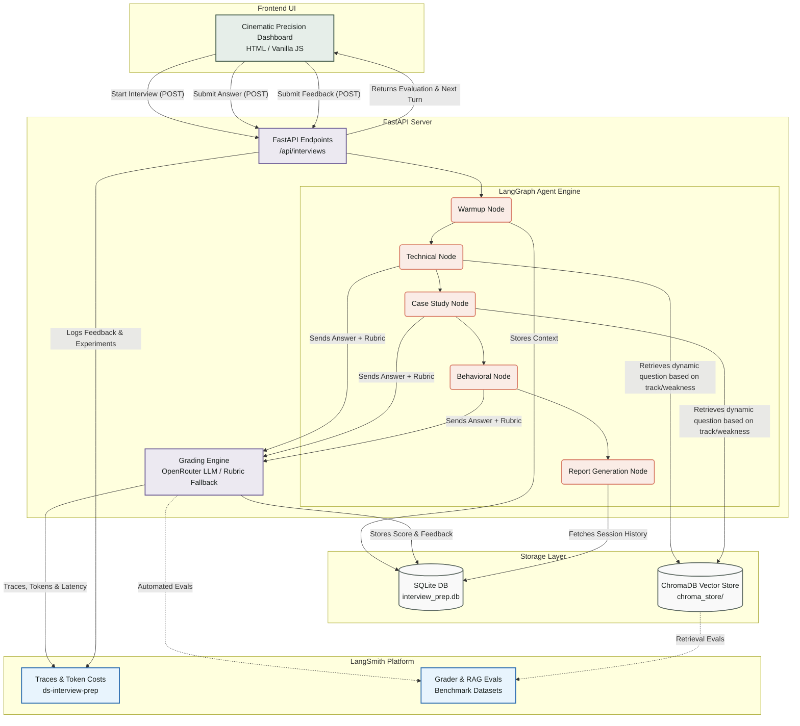
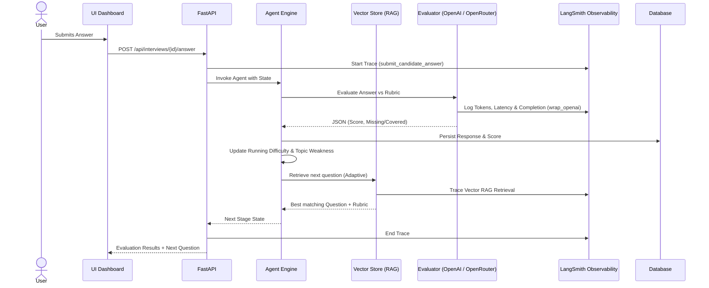

# Data Science Interview Prep Bot

An adaptive mock-interview application built for the Agentic AI & RAG capstone brief.

## Run

```powershell
python -m uvicorn app.main:app --reload
```

Open `http://127.0.0.1:8000`. The application creates `interview_prep.db` automatically.

## Enable LLM grading with OpenRouter & LangSmith Observability

Create or configure your `app/.env` file with your API keys:

```ini
# OpenRouter Configuration
OPENROUTER_API_KEY=your_openrouter_api_key_here
OPENROUTER_MODEL=openai/gpt-4o-mini
OPENROUTER_BASE_URL=https://openrouter.ai/api/v1

# LangSmith Observability & Evaluation
LANGCHAIN_TRACING_V2=true
LANGCHAIN_API_KEY=your_langsmith_api_key_here
LANGCHAIN_PROJECT=ds-interview-prep
LANGCHAIN_ENDPOINT=https://api.smith.langchain.com
```

Then run the application:
```powershell
python -m uvicorn app.main:app --reload
```
*(Environment variables from `app/.env` and `.env` are automatically loaded on startup).*

OpenRouter is used through its OpenAI-compatible base URL. The LLM receives only the question, reference answer, rubric, and learner answer, and returns a JSON score and feedback. If the provider is unavailable or returns invalid output, grading safely falls back to the local scorer.

---

## LangSmith Observability & Evaluation Suite

The application includes end-to-end integration with **LangSmith** for full production observability, automated evaluations, and safe experimentation:

### 1. Production Tracing & Token/Cost Monitoring
- **`wrap_openai` Client Wrapper**: Automatically records token usage (`prompt_tokens`, `completion_tokens`, `total_tokens`), latency, and OpenRouter LLM costs for each grading call.
- **Hierarchical Trace Trees**: Traces root answer submissions (`submit_candidate_answer`) down into grading, ChromaDB retrieval (`vector_rag_retrieval`), memory lookup (`history_tool_lookup`), and state graph transitions (`transition_graph`).
- **Run Metadata & Tagging**: Every trace is tagged with candidate attributes (`learner_id`, `interview_id`, `track`, `stage`, `difficulty`, `prompt_version`) for targeted filtering and debugging in the LangSmith dashboard.

### 2. Multi-Dimensional Quality Evaluation
The automated evaluation pipeline in `app/langsmith_eval.py` assesses LLM performance against expert-labelled holdout benchmarks across 4 dimensions:
* **`absolute_error`**: Absolute score delta vs expert benchmark.
* **`within_15_agreement`**: Percentage of evaluations within 15 points of expert baseline.
* **`feedback_quality`**: Verifies actionable, constructive guidance ($\ge 25$ characters).
* **`rubric_fidelity`**: Checks logical consistency between score and covered/missing concept breakdowns.

### 3. RAG Retrieval & Grounding Benchmark
* **Dataset (`ds-interview-rag-benchmark`)**: Tests ChromaDB `VectorRAG` semantic question retrieval across ML and Analytics tracks.
* **Evaluator (`metric_rag_topic_precision`)**: Quantifies topic precision and alignment with learner practice requirements.

### 4. Regression Testing & Model Comparison
* Run side-by-side experiments in LangSmith to safely compare candidate models (`gpt-4o-mini`, `claude-3.5-haiku`, etc.) or prompt revisions against the benchmark dataset before production deployment.

### 5. User Feedback Logging
* Capture candidate satisfaction ratings and qualitative notes, attached directly to LangSmith trace runs via `POST /api/feedback`.

---

## Design

### High-Level Architecture


### Execution Flow (Single Turn)


- **LangGraph staged agent:** explicit warmup → technical → case study → behavioral → report nodes, with stateful score, memory, difficulty, and transition nodes.
- **RAG:** semantic retrieval searches the curated question bank using the selected track, role goal, level, learner weak topics, and current stage; returned question bundles carry reference answers and rubrics.
- **Vector RAG:** ChromaDB persists embeddings for the full question, reference answer, rubric, stage, and track. A local `all-MiniLM-L6-v2` sentence-transformer retrieves semantically relevant question bundles; TF-IDF remains an offline-safe fallback.
- **Adaptive difficulty:** each scored response updates a running score. Strong performance increases difficulty, while a weaker answer holds or reduces it. Recent weak topics are prioritized; topics already mastered in prior sessions are deprioritized.
- **Evaluation:** an OpenRouter-backed LLM grades against the reference answer and weighted rubric; local weighted concept/reference scoring remains as a resilient fallback.
- **Context memory:** SQLite retains learner topic signals and response history across sessions.

## API

- `POST /api/interviews` — start interview (`learner_id`, `track`, `level`)
- `POST /api/interviews/{id}/answer` — submit an answer
- `GET /api/interviews/{id}/report` — final comprehensive report
- `GET /api/learners/{id}/history` — cross-session memory & performance context
- `POST /api/feedback` — submit candidate satisfaction score and feedback to LangSmith
- `GET /api/evaluation/validate` — expert-labelled benchmark comparison for the active grader
- `GET /api/evaluation/langsmith?type=all|grader|rag|regression` — trigger LangSmith automated evaluations

